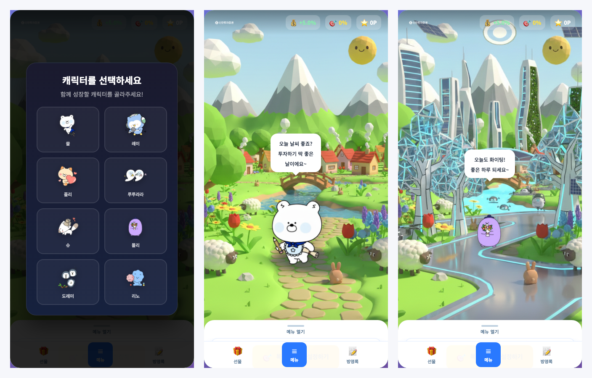
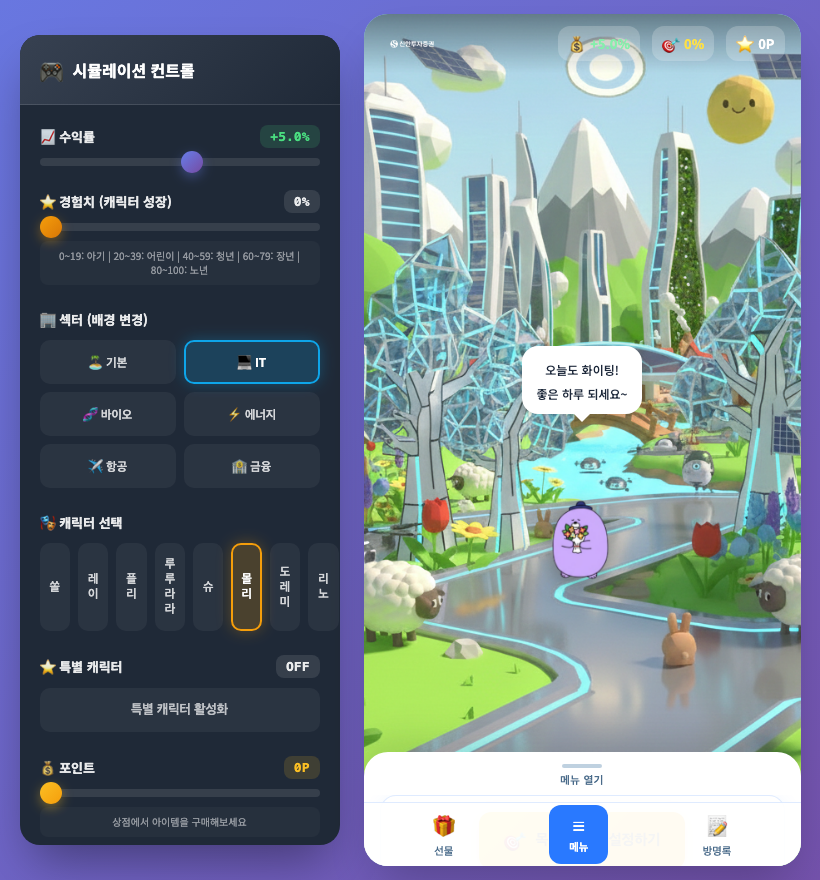

# Grow-Island 🏝️

**팀의 투자 성과가 섬과 캐릭터로 자라나는 게임형 투자 커뮤니티** — 신한투자증권 MTS에 붙이는 대학생 팀 투자 기능을 제안한 웹 프로토타입입니다.



<sub>왼쪽부터 캐릭터 선택 · 기본 섬 · IT 섹터에 투자했을 때의 섬</sub>

## 아이디어

주식 투자는 혼자 숫자를 보는 일이라 금방 지루해지고, 처음 시작하는 대학생에게는 진입 장벽이 높습니다. Grow-Island는 **4명이 한 팀**이 되어 함께 투자하고, 그 결과를 **눈에 보이는 섬과 캐릭터의 성장**으로 보여 줍니다.

- **팀 수익률 → 섬의 날씨**: 수익이 나면 맑고, 손실이면 비가 옵니다.
- **투자 섹터 → 섬의 모습**: 팀이 투자한 섹터에 따라 섬이 바뀝니다.

  | 섹터 | 섬 |
  |---|---|
  | 기본 | 🌿 푸른 초원 |
  | IT | 💻 첨단 테크 시티 |
  | 바이오 | 🧬 연구 단지 |
  | 에너지 | ⚡ 풍력·태양광 발전 섬 |
  | 항공/공항 | ✈️ 국제 공항 허브 |
  | 금융 | 🏦 금융 중심지 |

- **활동 → 캐릭터 성장**: 신한 프렌즈 캐릭터 8종 중 하나를 골라, 경험치에 따라 아기 → 어린이 → 청년 → 장년 → 노년의 5단계로 키웁니다.

## 주요 기능

| 분류 | 기능 |
|---|---|
| **매일 참여** | 출석 체크 룰렛 → 미니게임 하나가 무작위로 선택됩니다 |
| **미니게임** | 투자 밸런스 게임 · VS 퀴즈(주식 비교) · 차트 방향 맞히기 · 오늘의 투자 운세 |
| **팀 활동** | 팀원 포트폴리오와 댓글 · 팀 채팅(수익률 자랑) · 다른 팀이 남기는 방명록 · 목표 수익률 설정 |
| **보상** | 포인트 상점과 인벤토리(캐릭터·섬 꾸미기 아이템) · 선물 교환권(문화생활, 액티비티, 자기계발 등) |
| **이벤트** | **다함께 쏠(SOL)아 올려!** — 여름·겨울 방학마다 팀 평균 수익률로 겨루는 팀 대항전 |
| **오프라인 연계** | **신한 프렌즈 찾기** — 캠퍼스 지도 위에 숨은 캐릭터를 4명이 함께 찾는 보물찾기 (`/treasure-hunt.html`) |

## 시뮬레이션 패널

실제 MTS 계좌 데이터 대신, 화면 왼쪽의 **시뮬레이션 컨트롤**로 수익률·경험치·섹터·포인트를 직접 바꿔 가며 화면 변화를 확인할 수 있습니다.



## 기술 스택

- **React 19 + Vite**: 섬은 섹터별 배경 이미지를, 캐릭터는 경험치 단계별 이미지를 바꿔 끼우는 방식으로 그립니다.
- **Leaflet + OpenStreetMap**: 보물찾기 지도
- 서버 없이 동작하는 프런트엔드 프로토타입입니다. 채팅·방명록·목표 같은 상태는 브라우저 `localStorage`에 저장됩니다.

## 실행 방법

Node.js 18 이상이 필요합니다.

```bash
npm install
npm run dev       # 개발 서버 (http://localhost:5173)
npm run build     # 배포용 빌드 → dist/
npm run preview   # 빌드 결과 미리보기
```

## 폴더 구조

```
├── index.html
├── public/                  캐릭터·섬 배경 이미지, 보물찾기 페이지(treasure-hunt.html)
└── src/
    ├── App.jsx              메인 화면 (섬, 캐릭터, 메뉴, 시뮬레이션 패널)
    ├── components/          미니게임, 모달, 팀 대항전, 상점 등 18개 컴포넌트
    ├── config/sectorConfig.js   섹터별 이름·아이콘·색상
    └── game/IslandScene.js      Phaser 섬 장면 (실험용, 현재 화면에서는 사용하지 않음)
```

## 저작권 안내

캐릭터(쏠, 레이, 플리, 루루라라, 슈, 몰리, 도레미, 리노)를 포함한 **신한 프렌즈 이미지와 신한투자증권 로고의 권리는 신한금융그룹에 있습니다.** 이 저장소는 서비스 아이디어를 보여 주기 위한 비상업적 프로토타입입니다.
